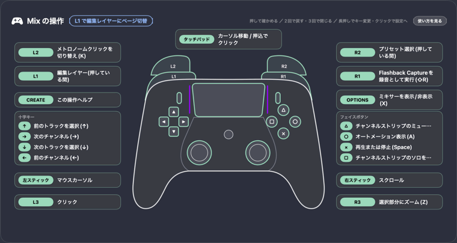

  

<h1 align="center">DaruGoro</h1>

  <b>ソファでゴロゴロしながら、PS5コントローラーでDAWを操作するMacアプリ。</b> 
  <b>Control your DAW from the sofa — with a PS5 DualSense controller.</b>

  <a href="https://github.com/amam335345/darugoro-site/releases/latest/download/DaruGoro.dmg"><b>Download for Mac (.dmg)</b></a> ·
  <a href="https://amam335345.github.io/darugoro-site/">配布ページ / Website</a> ·
  <a href="https://github.com/amam335345/darugoro-site/releases">Releases</a>

無料 · macOS 12 以降 · Free · macOS 12 or later

  

[日本語](#日本語) | [English](#english)

---

## 日本語

DaruGoro（だるごろ）は、PS5（DualSense）コントローラーを Mac の DAW コントローラーにするアプリです。ボタンを押すと、前面にある DAW（Logic Pro / Studio One）に合わせて割り当てたキーボードショートカットを送ります。デスクに向かわず、ソファでくつろいだまま、再生・録音・編集・ミックスができます。

### できること

- **DAW ごとのプリセット** — Logic Pro と Studio One のプリセットを用意。編集・並べ替え・書き出し・読み込みが自由にできます。
- **R2 でプリセットを切り替え** — R2 を引いたまま右スティックを倒すと、円形のメニューからプリセットを選べます。
- **L1 の編集レイヤー** — L1 を押している間、顔ボタンと十字キーが編集用の操作に切り替わります。
- **スティックを好きな役割に** — 十字キー・スクロール・マウスカーソル・矢印キーから選べます。
- **タッチパッドでマウス操作** — コントローラーのタッチパッドで、移動・クリック・ドラッグができます。
- **操作ヘルプ** — CREATE ボタンで、全部の割り当てをコントローラーの絵の周りに表示します。

  
  

R2 を引いて右スティックを回し、プリセットを切り替えます（左）。設定ウインドウでボタンを選ぶと、キーを変えられます（右）。

### ダウンロード

DaruGoro は無料です。Developer ID で署名し、Apple の公証を受けています。

- **[DaruGoro をダウンロード（.dmg）](https://github.com/amam335345/darugoro-site/releases/latest/download/DaruGoro.dmg)**
- 更新内容と過去の版は [Releases](https://github.com/amam335345/darugoro-site/releases) にあります。
- はじめて使うときの手順やアプリの消し方は、[配布ページ](https://amam335345.github.io/darugoro-site/)に書いています。

### 動作環境

- macOS 12 Monterey 以降
- PS5 DualSense ワイヤレスコントローラー（Bluetooth または USB）
- Logic Pro または Studio One（その他のアプリは「デフォルト」のプリセットで動きます）

### お礼について

DaruGoroは無料です。もし役に立ったら、[Ko-fi](https://ko-fi.com/amam335345) でお礼を送っていただけると嬉しいです。これからの開発の励みになります。 送らなくても、すべての機能を使えます。返信や返礼はありません。

気に入ったら、このページの右上の ☆ Star を押してもらえると励みになります。

### 商標について

DualSense、PlayStation および PS5 は Sony Interactive Entertainment Inc. の、Logic Pro は Apple Inc. の商標または登録商標です。DaruGoro はこれらの企業と提携しておらず、承認も受けていません。

---

## English

DaruGoro turns a PS5 (DualSense) controller into a controller for your DAW on Mac. Press a button and DaruGoro sends the keyboard shortcut you assigned for the app in front — Logic Pro or Studio One — so you can play, record, edit and mix without sitting at your desk.

### What it does

- **Presets per DAW** — Ready-made presets for Logic Pro and Studio One. Edit, reorder, export and import them freely.
- **Switch presets with R2** — Hold R2 and tilt the right stick to pick a preset from a circular menu.
- **L1 editing layer** — While L1 is held, the face buttons and D-pad switch to editing actions.
- **Sticks, your way** — Use each stick as a D-pad, scroll wheel, mouse cursor or arrow keys.
- **Touchpad mouse** — Move, click and drag with the controller's touchpad.
- **On-screen help** — Press CREATE to see every assignment drawn around the controller.

  
  

Hold R2 and turn the right stick to switch presets (left). Pick a button in the settings window to change its key (right). Screenshots are from the Japanese UI.

### Download

DaruGoro is free. The app is signed with a Developer ID and notarized by Apple.

- **[Download DaruGoro (.dmg)](https://github.com/amam335345/darugoro-site/releases/latest/download/DaruGoro.dmg)**
- Release notes and older versions are on [Releases](https://github.com/amam335345/darugoro-site/releases).
- First-launch steps and how to uninstall are on the [website](https://amam335345.github.io/darugoro-site/#english).

### Requirements

- macOS 12 Monterey or later
- A PS5 DualSense wireless controller (Bluetooth or USB)
- Logic Pro or Studio One (other apps work with the “Default” preset)

### Support DaruGoro

DaruGoro is free. If it helps you, I'd be glad if you sent a thank-you on [Ko-fi](https://ko-fi.com/amam335345). It would encourage me to keep developing the app. Every feature works even if you don't. There are no replies or rewards.

If you like it, a ☆ Star at the top right of this page would mean a lot.

### Trademarks

DualSense, PlayStation and PS5 are trademarks or registered trademarks of Sony Interactive Entertainment Inc., and Logic Pro is a trademark or registered trademark of Apple Inc. DaruGoro is not affiliated with, nor endorsed by, these companies.
