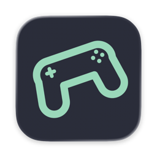
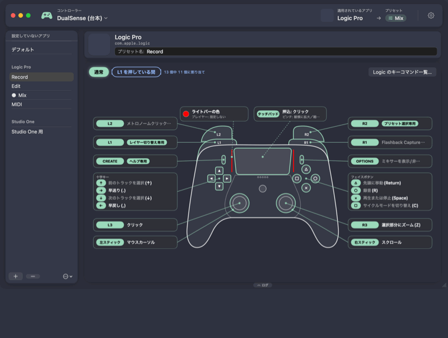
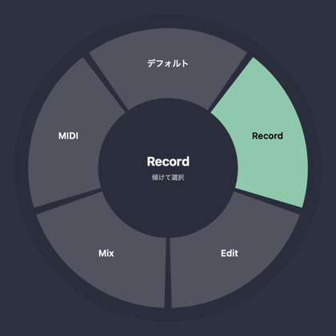

  

<h1 align="center">DaruGoro</h1>

  <b>ゲーム感覚でDAWをいじれるMacアプリ</b> 
  <b>A Mac app that lets you tinker with your DAW like a game</b>

  ソファでゴロゴロしながら、PS5コントローラーでDAWを操作するMacアプリ。 
  Control your DAW from the sofa — with a PS5 DualSense controller.

  <a href="https://github.com/amam335345/darugoro-site/releases/latest/download/DaruGoro.dmg"><b>Download for Mac (.dmg)</b></a> ·
  <a href="https://amam335345.github.io/darugoro-site/">配布ページ / Website</a> ·
  <a href="https://github.com/amam335345/darugoro-site/releases">Releases</a>

無料 · macOS 12 以降 · Free · macOS 12 or later

  

[日本語](#日本語) | [English](#english)

---
# 日本語

## DaruGoro とは

DaruGoro（だるごろ）は、デスクに向き合いすぎず、だるっとゴロゴロくつろぎながら、DualSense(PS5)コントローラでDAW操作を行うことをコンセプトとしたmacOSアプリです。

DaruGoroではボタン割り当てができ、DualSenseコントローラをUSB-CまたはBluetoothで接続後、マウスやキーボード代わりとしてお使いいただけます。

### こんな方におすすめ
- 楽器を構えたまま、デスクに戻らず録音したい方
- コントローラを拡張デバイスとして使いたい方
- キーボード自体に嫌気が差した方

### 特長

- **DAWアプリごとのプリセット** — アプリごとにプリセットを用意できます。自分の好きなボタン配置を選べ、設定ファイルのインポート/エクスポートもできます。
- **スティックを好きな役割に** — 十字キー(ゲームパッドの十字と同じ動作)・スクロール・マウスカーソル・矢印キーを選べます。
- **タッチパッドでマウス操作** — DualSenseのタッチパッドで、マウス移動・タップクリック・ドラッグ・Forceクリックができます。

  

- **プリセット切替** — プリセット切替ボタン(デフォルト:R2)でプリセット一覧が円形のメニューで表示されスティック操作でプリセットを簡単に切り替えられます。

  

- **レイヤー切り替え** — レイヤー切り替えボタン(デフォルト:L1)を押している間のボタン割り当てできるため、割り当てを拡張できます。
- **操作ヘルプ** — ヘルプボタン(デフォルト:CREATE)で全ての割り当てをコントローラーの絵の周りに表示します。

  

### ダウンロード

DaruGoro は無料です。Developer ID で署名し、Apple の公証を受けています。

- **[DaruGoro をダウンロード（.dmg）](https://github.com/amam335345/darugoro-site/releases/latest/download/DaruGoro.dmg)**
- Homebrew を使っているときは、`brew install --cask amam335345/darugoro/darugoro` でも入れられます（新しい版にするときは `brew upgrade --cask darugoro`）。
- 更新内容と過去の版は [Releases](https://github.com/amam335345/darugoro-site/releases) にあります。
- はじめて使うときの手順は、配布ページの[「はじめて使うとき」](https://amam335345.github.io/darugoro-site/#ja-first-launch)に書いています。
- アプリの消し方は、配布ページの[「アプリの消し方」](https://amam335345.github.io/darugoro-site/#ja-uninstall)に書いています。

### 動作環境

- macOS 12 Monterey 以降
- PS5 DualSense ワイヤレスコントローラー（Bluetooth または USB）
- Logic Pro または Studio One（その他のアプリは「デフォルト」のプリセットで動きます）

### お礼について

DaruGoroは無料です。もし役に立ったら、[Ko-fi](https://ko-fi.com/amam335345) でお礼を送っていただけると嬉しいです。これからの開発の励みになります。

送らなくても、すべての機能を使えます。返信や返礼はありません。

### 商標について

DualSense、PlayStation および PS5 は Sony Interactive Entertainment Inc. の、Logic Pro は Apple Inc. の、Studio One は PreSonus Audio Electronics, Inc. の商標または登録商標です。DaruGoro はこれらの企業と提携しておらず、承認も受けていません。

---

# English

## What is DaruGoro?

DaruGoro is a macOS app built around one idea: without staying glued to your desk, lounge around lazily while you run your DAW with a DualSense (PS5) controller.

You can assign actions to the buttons. Connect a DualSense controller over USB-C or Bluetooth, and use it in place of your mouse and keyboard.

### Who it's for
- Anyone who wants to record with an instrument in hand, without going back to the desk
- Anyone who wants to use a controller as an extra input device
- Anyone who has simply had enough of the keyboard

### Features

- **Presets for each DAW** — Keep presets for each app. Pick the button layout you like, and import or export your settings file.
- **Sticks, your way** — Choose D-pad (works like a gamepad's D-pad), scroll, mouse cursor or arrow keys.
- **Touchpad mouse** — Move the mouse, tap to click, drag and Force Click with the DualSense touchpad.

  

- **Preset switching** — Press the preset button (default: R2) to show your presets in a circular menu, and switch between them easily with the stick.

  

- **Layer switching** — While the layer button (default: L1) is held, the buttons use a second set of assignments, so you can assign more actions.
- **On-screen help** — Press the help button (default: CREATE) to see every assignment drawn around the controller.

  

### Download

DaruGoro is free. The app is signed with a Developer ID and notarized by Apple.

- **[Download DaruGoro (.dmg)](https://github.com/amam335345/darugoro-site/releases/latest/download/DaruGoro.dmg)**
- With Homebrew, you can also run `brew install --cask amam335345/darugoro/darugoro` (update with `brew upgrade --cask darugoro`).
- Release notes and older versions are on [Releases](https://github.com/amam335345/darugoro-site/releases).
- For setup steps, see [First launch](https://amam335345.github.io/darugoro-site/#en-first-launch) on the website.
- To remove the app, see [Uninstalling](https://amam335345.github.io/darugoro-site/#en-uninstall) on the website.

### Requirements

- macOS 12 Monterey or later
- A PS5 DualSense wireless controller (Bluetooth or USB)
- Logic Pro or Studio One (other apps work with the “Default” preset)

### Support DaruGoro

DaruGoro is free. If it helps you, I'd be glad if you sent a thank-you on [Ko-fi](https://ko-fi.com/amam335345). It would encourage me to keep developing the app.

Every feature works even if you don't. There are no replies or rewards.

### Trademarks

DualSense, PlayStation and PS5 are trademarks or registered trademarks of Sony Interactive Entertainment Inc., Logic Pro is a trademark or registered trademark of Apple Inc., and Studio One is a trademark or registered trademark of PreSonus Audio Electronics, Inc. DaruGoro is not affiliated with, nor endorsed by, these companies.
